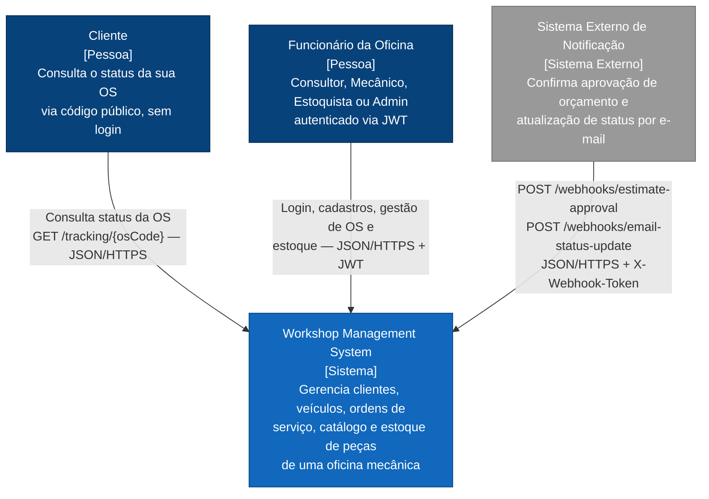
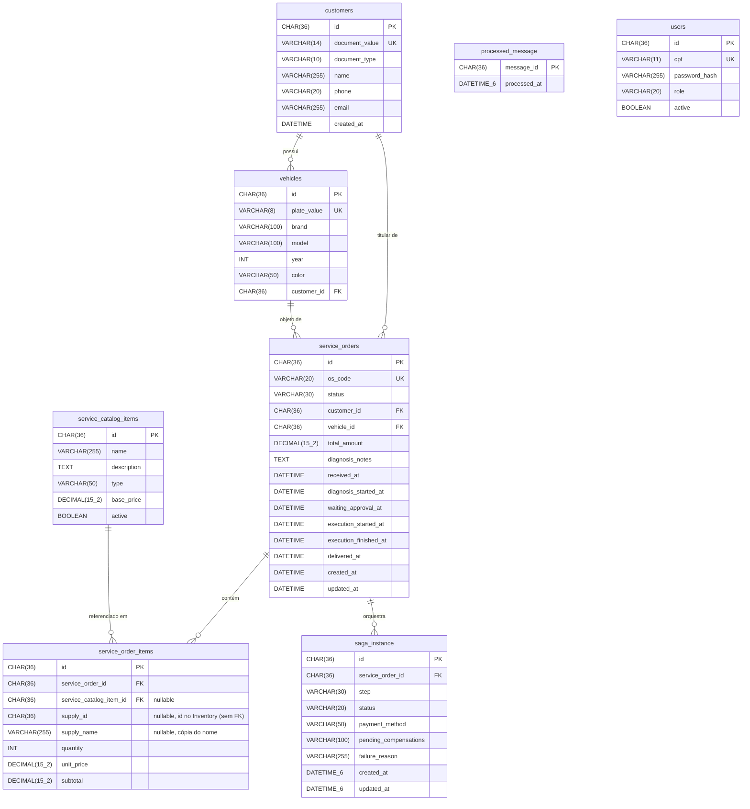

# Workshop Management System

MVP de back-end para gestão de oficina mecânica — FIAP Tech Challenge (Pós-Graduação em Arquitetura de Software, Turma 15SOAT).

## Visão Geral

Sistema integrado para controle de ordens de serviço (OS), clientes, veículos, catálogo de serviços, peças/insumos e rastreamento público de OS. Construído com Java 17, Spring Boot 3.2, MySQL e arquitetura em camadas baseada em DDD.

---

## Arquitetura

O projeto segue **Clean Architecture** (camadas `domain` → `application` → `infrastructure`/`interfaces`, com inversão de dependência). Visão de alto nível (C4 Model, Nível 1 — Contexto):



Diagramas C4 completos (Contexto, Containers, Componentes), a visão de nuvem da Fase 3 e os diagramas de sequência (autenticação, abertura de OS): **[docs/ARCHITECTURE.md](docs/ARCHITECTURE.md)**.

### Documentação da Fase 3

- **[ADRs](docs/adr/)** — decisões arquiteturais permanentes (ex.: CPF como login, NLB vs. ALB, roles IAM fixos do Lab)
- **[RFCs](docs/rfc/)** — decisões técnicas com contexto e alternativas (escolha da nuvem, do banco, da estratégia de autenticação)
- **[docs/DEPLOYMENT.md](docs/DEPLOYMENT.md)** — infraestrutura, CI/CD e o deploy real na AWS
- Repositórios da infraestrutura: [API Gateway + Lambda](https://github.com/Adriana-Meyer/fiap-tech-challenge-API-gateway-function-serverless) · [os-infrastructure — VPC + EKS](https://github.com/Adriana-Meyer/fiap-tech-challenge-os-infrastructure) · [os-database-infrastructure — RDS](https://github.com/Adriana-Meyer/fiap-tech-challenge-os-database-infrastructure)

---

## Tecnologias

| Camada | Tecnologia |
|---|---|
| Linguagem | Java 17 |
| Framework | Spring Boot 3.2.5 |
| Segurança | Spring Security + JWT (JJWT 0.12) |
| Persistência | Spring Data JPA + Hibernate 6 + MySQL 8 |
| Migrations | Flyway |
| Documentação | SpringDoc OpenAPI 3 / Swagger UI |
| Testes | JUnit 5 + Testcontainers + JaCoCo |
| Build | Maven 3.9 |
| Container | Docker + Docker Compose |

---

## Pré-requisitos

- Java 17+
- Maven 3.9+
- Docker Desktop (para executar via Docker Compose ou para os testes de integração)

---

## Executando com Docker Compose

```bash
# Build e start (MySQL + aplicação)
docker-compose up --build

# Somente subir (sem rebuild)
docker-compose up

# Parar e remover os containers
docker-compose down

# Parar e remover containers + volume do banco
docker-compose down -v
```

A aplicação ficará disponível em `http://localhost:8080`.
O Flyway aplicará automaticamente as migrations V1 (schema), V2 (catálogo/peças) e V3 (usuários) na primeira inicialização.

---

## Executando localmente (sem Docker)

1. Suba apenas o banco de dados:
   ```bash
   docker-compose up mysql
   ```

2. Execute a aplicação:
   ```bash
   mvn spring-boot:run
   ```

---

## Variáveis de Ambiente

| Variável | Padrão | Descrição |
|---|---|---|
| `JWT_SECRET` | `dev-only-secret-must-be-at-least-64-characters-long-for-hs512-ok` | Chave secreta para assinar os tokens JWT. **Substitua em produção.** |
| `SPRING_PROFILES_ACTIVE` | `default` | Use `docker` quando executar via Docker Compose |
| `NEW_RELIC_LICENSE_KEY` | *(vazio)* | License key de ingestão do New Relic. Sem ela, o agente Java simplesmente não se ativa (log de aviso, sem quebrar a aplicação) — não é necessária pra rodar localmente. |

O perfil `docker` (`application-docker.yml`) configura a URL do banco para o container MySQL interno.

---

## Observabilidade (New Relic)

O agente Java do New Relic é anexado via `-javaagent` na imagem Docker (ver [`Dockerfile`](Dockerfile)), configurado inteiramente por variáveis de ambiente (`k8s/01-config/app-configmap.yaml` + `NEW_RELIC_LICENSE_KEY` no Secret) — nenhum `newrelic.yml` é commitado no repositório.

- **Logs estruturados em JSON**: [`logback-spring.xml`](src/main/resources/logback-spring.xml) usa `LogstashEncoder` pra formatar todo log como JSON.
- **Correlação entre requisições**: com `application_logging.local_decorating` habilitado, o agente injeta `trace.id`/`span.id` no MDC de cada log — como o encoder inclui automaticamente todo o MDC, cada linha de log JSON já sai correlacionada com o trace da requisição, sem nenhum código manual de correlação.
- **Métrica "tempo médio por status"**: `domain/service/MetricsPublisher` (porta) + `infrastructure/observability/NewRelicMetricsPublisher` (adapter) publicam um custom event `ServiceOrderStatusDuration` nos três pontos de transição de status da OS (`CompleteDiagnosisUseCase`, `FinishServiceItemExecutionUseCase`, `DeliverServiceOrderUseCase`). Dashboard via NRQL:
  ```sql
  SELECT average(durationMinutes) FROM ServiceOrderStatusDuration FACET status
  ```
- **Métricas de cluster** (CPU/memória dos pods, healthchecks): integração `nri-bundle` já provisionada no [os-infrastructure](https://github.com/Adriana-Meyer/fiap-tech-challenge-os-infrastructure).

Exemplos reais de cada um desses recursos (APM, dashboard customizado, logs correlacionados, traces distribuídos) em [docs/OBSERVABILITY.md](docs/OBSERVABILITY.md).

---

## Documentação da API (Swagger UI)

Com a aplicação em execução, acesse:

```
http://localhost:8080/swagger-ui.html
```

### Como autenticar no Swagger UI

1. Faça login em **POST /api/v1/auth/login** com o CPF e a senha de um dos usuários abaixo (a autenticação é por CPF, não e-mail — ver [ADR 0006](docs/adr/0006-cpf-replaces-email-login.md))
2. Copie o valor do campo `token` da resposta
3. Clique no botão **Authorize** (cadeado) no topo da página
4. Cole o token no campo **Value** (sem o prefixo `Bearer `) e clique em **Authorize**

A partir daí todos os endpoints protegidos enviarão o header `Authorization: Bearer <token>` automaticamente.

### Importando no Postman / Insomnia

A especificação OpenAPI é gerada automaticamente em tempo de execução e pode ser importada em qualquer cliente REST, sem depender de uma collection estática mantida à parte:

```
http://localhost:8080/v3/api-docs
```

Postman: *Import → Link* · Insomnia: *Import → From URL*. Isso traz todas as rotas, schemas e exemplos já tipados, sempre em sincronia com o código.

---

## Usuários Padrão (seed V3 + V4)

Login por **CPF** (não e-mail — ver [ADR 0006](docs/adr/0006-cpf-replaces-email-login.md)):

| CPF | Senha | Role | Capacidades |
|---|---|---|---|
| `11144477735` | `workshop123` | `ROLE_ADMIN` | Acesso total |
| `22255588846` | `workshop123` | `ROLE_CONSULTANT` | Criar OS, aprovar/rejeitar orçamento, entregar veículo, CRUD clientes/veículos |
| `33366699957` | `workshop123` | `ROLE_MECHANIC` | Iniciar diagnóstico, adicionar itens, registrar execução por item |
| `44477722214` | `workshop123` | `ROLE_STOCKIST` | Visualizar e ajustar estoque de peças/insumos |

---

## Fluxo Completo via Swagger

> **Fase 4:** o OS Service é o orquestrador da saga. Orçamento, estoque, pagamento e fila de execução pertencem a outros serviços (Billing, Inventory, Execution), e a OS só muda de status quando eles respondem. O estado de cada etapa fica em `GET /api/v1/service-orders/{id}/saga`.
>
> Os comandos da saga saem por filas SQS e as respostas chegam por um tópico SNS; veja "Mensageria da saga" abaixo.

### 1. Autenticação
```
POST /api/v1/auth/login
Body: { "cpf": "11144477735", "password": "workshop123" }
→ Copie o token e autorize no Swagger
```

### 2. Cadastros iniciais (como consultor ou admin)
```
POST /api/v1/customers   → cadastrar cliente (use CPF ou CNPJ no campo documentNumber)
POST /api/v1/vehicles    → cadastrar veículo (vincule ao customerId obtido acima)
```

### 3. Abertura de OS (como consultor ou admin)
```
POST /api/v1/service-orders   → { "customerId": "...", "vehicleId": "..." }
→ OS criada com status RECEIVED e um osCode (ex: OS-2026-00001)
```

### 4. Diagnóstico (como mecânico)
```
PATCH /api/v1/service-orders/{id}/diagnosis/start
  → status: IN_DIAGNOSIS

POST /api/v1/service-orders/{id}/items
  → { "serviceCatalogItemId": "...", "quantity": 1 }   (para serviço)
  → { "supplyId": "...", "quantity": 2 }                (para peça/insumo)
  A peça é consultada no Inventory (REST) e a OS guarda uma cópia do nome e do preço.
  Se o Inventory estiver fora do ar, a resposta é 503.

POST /api/v1/service-orders/{id}/diagnosis/complete
  → { "diagnosisNotes": "Descrição do diagnóstico" }
  → a OS continua IN_DIAGNOSIS e o Billing é chamado para calcular o orçamento;
    quando ele responde, a OS passa a WAITING_APPROVAL com o total.
  Exige pelo menos um serviço na OS.
```

### 5. Aprovação do orçamento (como consultor ou admin)
```
PATCH /api/v1/service-orders/{id}/estimate/approve
  → corpo opcional: { "paymentMethod": "credit-card" }   (padrão: credit-card)
  → inicia a saga: reserva de estoque (Inventory) → pagamento (Billing) → fila de execução (Execution).
    A OS passa a IN_EXECUTION quando o Execution confirma a fila.

# Se alguma etapa falhar, as anteriores são desfeitas e a OS vai para CANCELLED:
#   estoque insuficiente   → cancela o orçamento
#   pagamento recusado     → libera o estoque e cancela o orçamento
#                            (use paymentMethod "mock-decline" para provocar)
#   fila de execução falha → estorna o pagamento e libera o estoque

# Se o cliente rejeitar:
PATCH /api/v1/service-orders/{id}/estimate/reject    → volta para IN_DIAGNOSIS
```

### 6. Execução (como mecânico)
A fila de execução agora é do **Execution Service** (`/api/v1/executions/...`). Quando o último serviço é concluído lá, o Execution avisa a saga e a OS passa a `FINISHED`; o estoque reservado é então consumido no Inventory.

### 7. Entrega (como consultor ou admin)
```
PATCH /api/v1/service-orders/{id}/deliver   → status: DELIVERED
```

### 8. Rastreamento público (sem autenticação)
```
GET /api/v1/tracking/{osCode}   → status simplificado para o cliente
```

### 9. Gestão de estoque
Feita no **Inventory Service** (`/api/v1/supplies/...`); não existe mais neste serviço.

---

## Mensageria da saga

Topologia (cada peça é provisionada por um repositório de infraestrutura):

```
OS ──GenerateBudget, ProcessPayment, CancelBudget, RefundPayment──▶ fila billing-commands    ──▶ Billing
OS ──ReserveStock, ReleaseStock, ConsumeStock─────────────────────▶ fila inventory-commands  ──▶ Inventory
OS ──EnqueueExecution─────────────────────────────────────────────▶ fila execution-commands  ──▶ Execution

Billing / Inventory / Execution ──respostas──▶ tópico SNS saga-events ──▶ fila os-saga-events ──▶ OS
```

- **Comandos:** SQS ponto a ponto, uma fila por serviço, cada uma com DLQ (`<fila>-dlq`). Ficam no `*-infrastructure` do serviço que consome.
- **Respostas:** todas vão para o tópico `saga-events`, assinado pela fila `os-saga-events` com **entrega bruta** (`RawMessageDelivery`), para o corpo chegar como o envelope abaixo. O tópico e a fila ficam no `os-infrastructure`. O atributo de mensagem `type` permite filtros por assinatura no futuro.
- **Envelope** (igual nos dois sentidos; `payload` leva só os campos próprios da mensagem):

```json
{ "messageId": "…", "sagaId": "…", "serviceOrderId": "…", "type": "GenerateBudget", "payload": { … } }
```

| Comando (OS → serviço) | `payload` | Respostas possíveis |
|---|---|---|
| `GenerateBudget` | `items: [{ description, unitPrice, quantity }]` | `BudgetGenerated { totalAmount }` |
| `ReserveStock` | `items: [{ supplyId, quantity }]` (vazio para OS sem peças) | `StockReserved` · `StockReservationFailed { reason }` |
| `ProcessPayment` | `paymentMethod` | `PaymentApproved` · `PaymentDeclined { reason }` |
| `EnqueueExecution` | `tasks: [{ taskId, serviceId, serviceName, serviceType }]` | `ExecutionEnqueued` · `ExecutionEnqueueFailed { reason }` |
| (Execution, ao concluir a última tarefa) | | `ExecutionCompleted` |
| `ConsumeStock` | (vazio) | `StockConsumed` |
| `ReleaseStock` (compensação) | (vazio) | `StockReleased` |
| `CancelBudget` (compensação) | (vazio) | `BudgetCancelled` |
| `RefundPayment` (compensação) | (vazio) | `PaymentRefunded` |

Garantias e decisões:

- **Falha de envio desfaz a transação:** o publicador envia de forma síncrona e lança a exceção; a OS não avança se o comando não saiu.
- **Respostas idempotentes:** o OS descarta mensagem repetida pelo `messageId` (tabela `processed_message`). Cada serviço deriva o `messageId` da resposta do `messageId` do comando, então uma reentrega gera a mesma resposta e é descartada. O `ExecutionCompleted` tem um id por saga.
- **Mensagem que falha vai para a DLQ:** JSON inválido, tipo desconhecido ou um tratamento que lança exceção não são confirmados; o SQS reentrega e, ao passar do máximo de tentativas, move para `os-saga-events-dlq`.
- **Filas são do Terraform:** o OS não cria filas e falha na subida se `os-saga-events` não existir.
- **`sagaId` em todo log:** o listener coloca o `sagaId` no MDC, e ele sai nos logs JSON, para rastrear uma saga mesmo se o trace do New Relic não atravessar o SQS.
- Variáveis: `EVENTS_QUEUE`, `BILLING_COMMANDS_QUEUE`, `INVENTORY_COMMANDS_QUEUE`, `EXECUTION_COMMANDS_QUEUE` (padrões acima), `AWS_REGION` e `MESSAGING_ENABLED` (`false` desliga o listener).
- Sem outbox: o comando é publicado antes do commit. Se o commit falha depois do envio, o comando já saiu; os receptores são idempotentes. O outbox transacional fica documentado como melhoria.

## Executando os Testes

```bash
# Todos os testes (unitários + integração)
mvn test

# Apenas testes de integração
mvn test -Dtest=AuthIntegrationTest,ServiceOrderLifecycleIntegrationTest

# Relatório de cobertura JaCoCo
mvn verify
# Relatório em: target/site/jacoco/index.html
```

Para ver os quatro serviços reais conversando, com o fluxo feliz e as duas compensações, use o ambiente em [`e2e/`](e2e/README.md): `docker compose -f e2e/docker-compose.yml up -d --build` e `bash e2e/run-e2e.sh`.

> Os testes de integração requerem Docker Desktop em execução. O Testcontainers sobe um MySQL 8.0 e, nos de mensageria, um LocalStack (SQS e SNS reais). `SagaMessagingIntegrationTest` roda a topologia completa: o teste faz o papel de Billing, Inventory e Execution.

---

## Estrutura do Projeto

```
src/main/java/com/fiap/workshop/management/
├── domain/          # Entidades, Value Objects, interfaces de repositório, domain services
├── application/     # Use cases, DTOs (Commands e Responses)
├── infrastructure/  # JPA entities, adapters, segurança JWT, configurações
└── interfaces/rest/ # Controllers REST, GlobalExceptionHandler
```

O domínio é POJO puro — testável sem Spring. As entidades JPA ficam na camada de infraestrutura e são mapeadas para o domínio por adapters.

---

## Modelagem do Banco de Dados

### Escolha do Banco — MySQL 8

O MySQL foi escolhido pelos seguintes motivos:

| Critério | Justificativa |
|---|---|
| **Relacionamentos** | Os dados do sistema são fortemente relacionais: clientes possuem veículos, veículos possuem OS, OS possuem itens que referenciam serviços e peças. Um banco relacional é o modelo natural para esse domínio. |
| **ACID** | Transações ACID garantem consistência no controle de estoque (decremento na aprovação do orçamento) e nos cálculos financeiros dos totais das OS. |
| **Integridade referencial** | Chaves estrangeiras com `ENGINE=InnoDB` impedem, por exemplo, exclusão de clientes com OS em aberto ou veículos vinculados. |
| **Maturidade e ecossistema** | Amplo suporte no ecossistema Spring (Spring Data JPA + Hibernate), drivers estáveis, e fácil containerização com a imagem oficial `mysql:8.0`. |
| **Flyway** | Migrações versionadas garantem que o schema evolua de forma controlada e reproduzível em qualquer ambiente (local, CI, produção). |

### Diagrama Entidade-Relacionamento



> **Nota:** Um `service_order_item` representa serviço **ou** peça/insumo — `service_catalog_item_id` e `supply_id` são mutuamente opcionais, com a restrição `CHECK` garantindo que ao menos um esteja preenchido. A peça pertence ao Inventory, por isso `supply_id` não é chave estrangeira: a OS guarda o id, o nome e o preço da peça no momento em que ela foi adicionada.

---

## Deploy e Infraestrutura

Além da execução local via Docker Compose, o projeto tem uma esteira completa de containerização, orquestração e entrega contínua:

- **Docker** — imagem multi-stage (build Maven + runtime `eclipse-temurin:17-jre`, usuário não-root), ver [`Dockerfile`](Dockerfile).
- **Kubernetes** — manifests em [`k8s/`](k8s/), organizados em estágios ordenados (`00-namespace` → `01-config` → `03-app`), incluindo HPA (1–5 réplicas, CPU/memória 70%). O banco é o RDS gerenciado do [os-database-infrastructure](https://github.com/Adriana-Meyer/fiap-tech-challenge-os-database-infrastructure), não um pod no cluster.
- **CI/CD** — GitHub Actions ([`.github/workflows/`](.github/workflows/)): build + testes (gate JaCoCo 80%) em todo push/PR, build & push de imagem no push para `develop`/`main` (`ci-cd.yml`); deploy real na AWS via `deploy-aws.yml`, disparado manualmente (`workflow_dispatch`) contra o EKS do [os-infrastructure](https://github.com/Adriana-Meyer/fiap-tech-challenge-os-infrastructure) — ver [Deploy real na AWS](docs/DEPLOYMENT.md#deploy-real-na-aws-fase-3) para detalhes.

Ver [docs/DEPLOYMENT.md](docs/DEPLOYMENT.md) para o passo a passo completo do deploy real na AWS.

Diagrama de infraestrutura, detalhamento do pipeline de CI/CD e o passo a passo completo: **[docs/DEPLOYMENT.md](docs/DEPLOYMENT.md)**.
