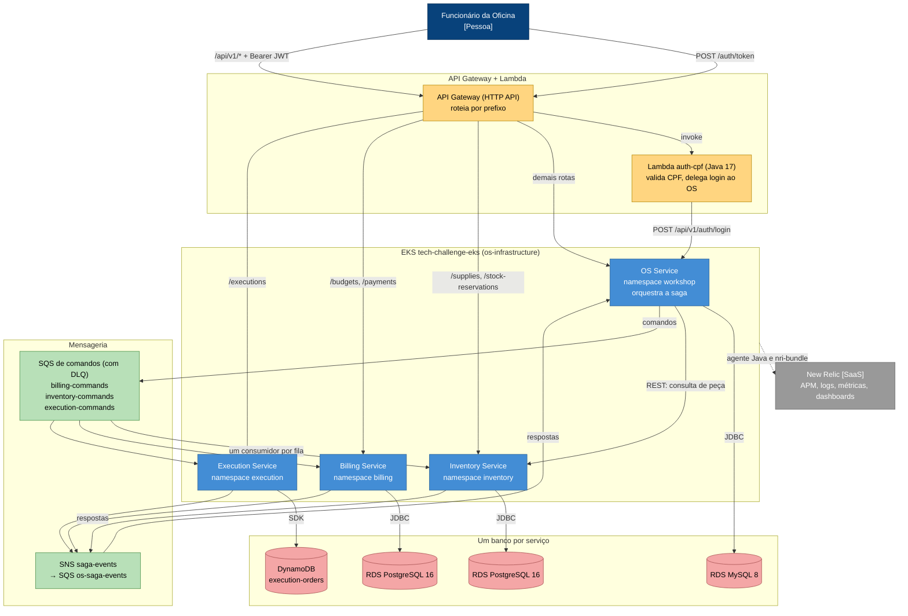
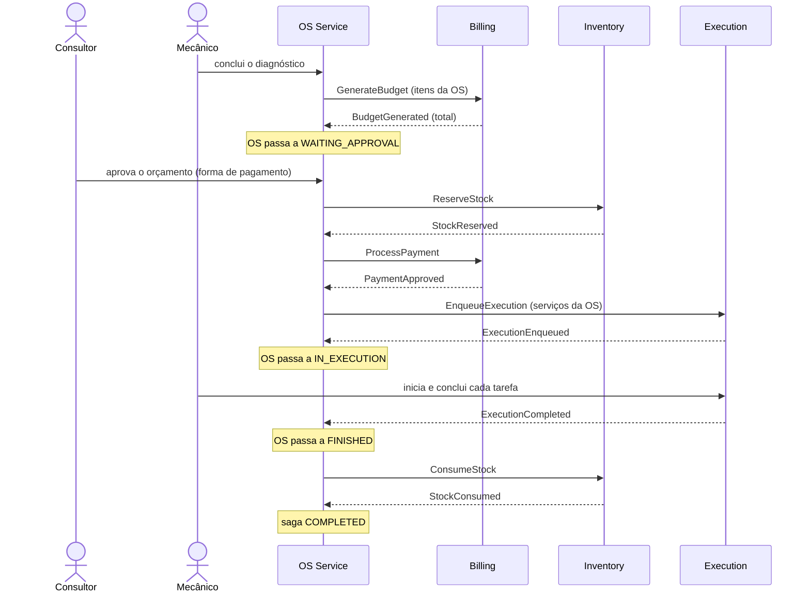
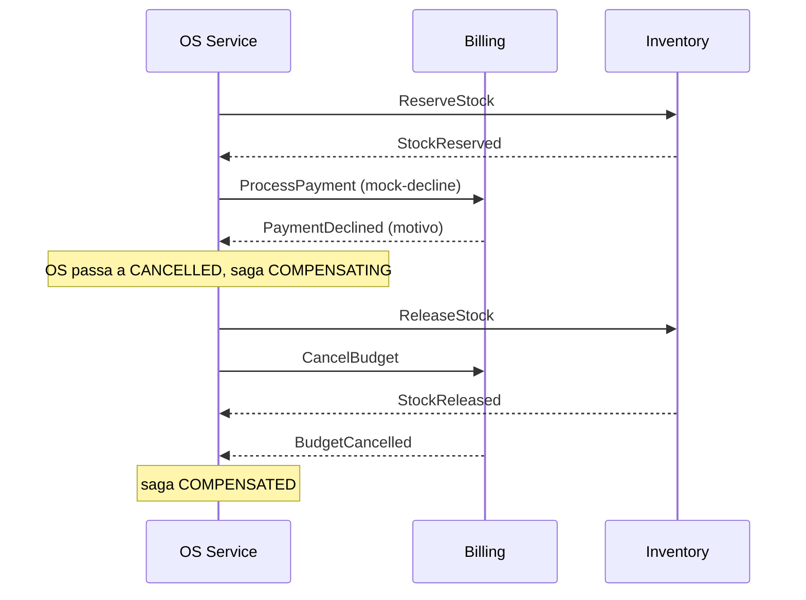
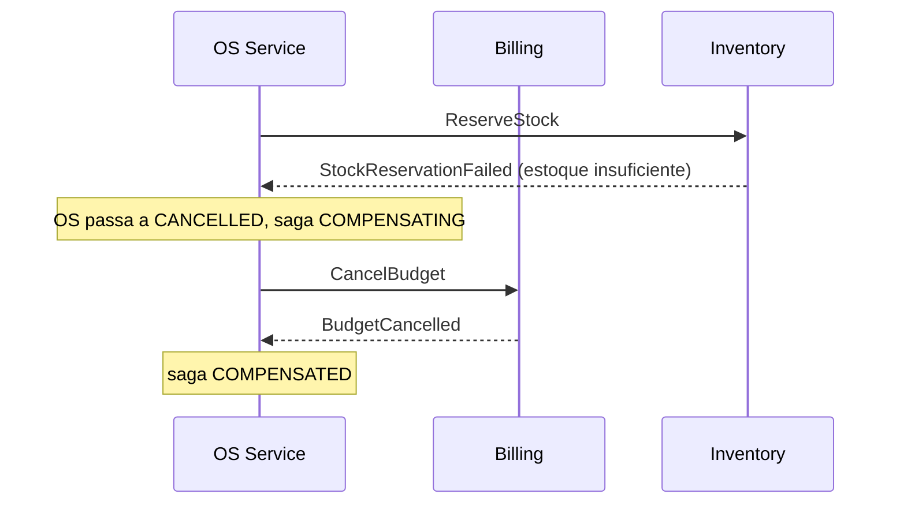
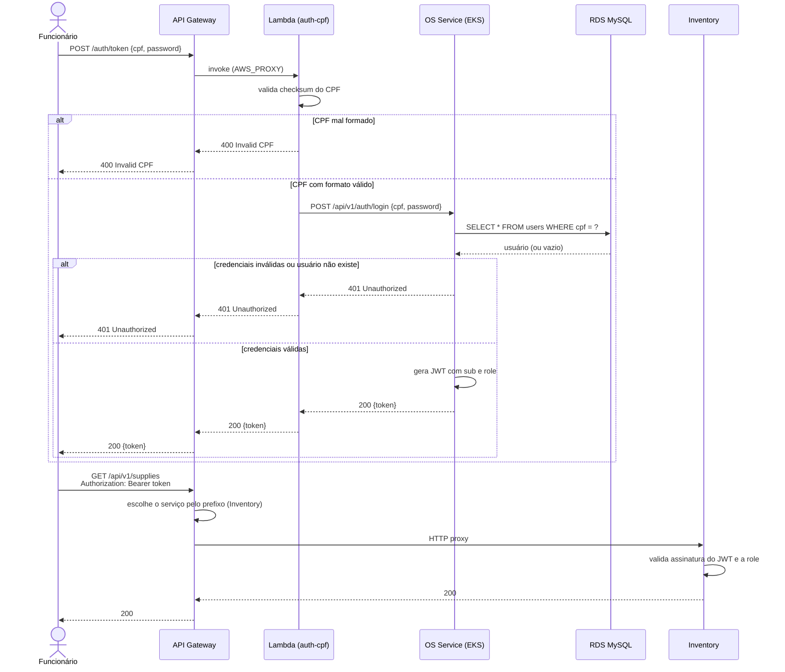
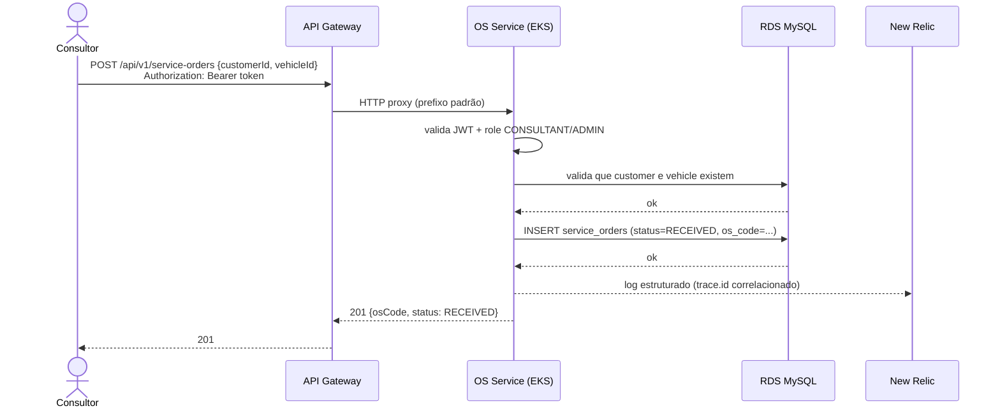
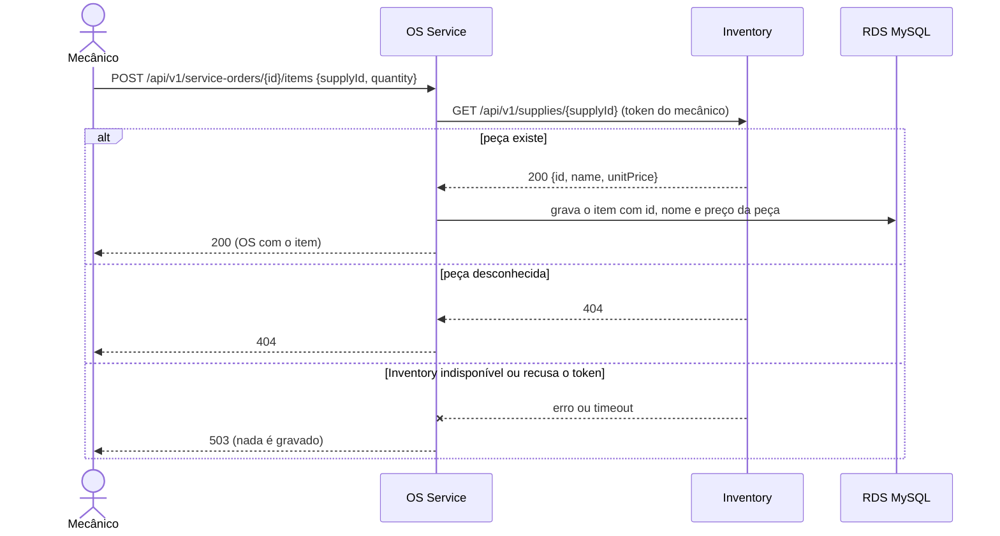
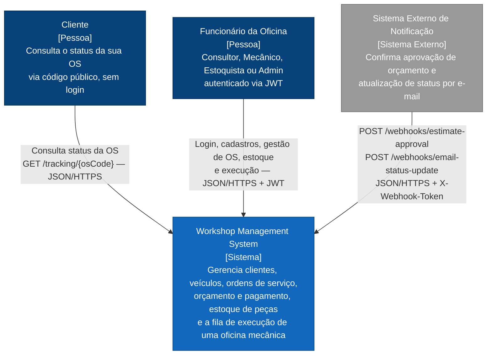
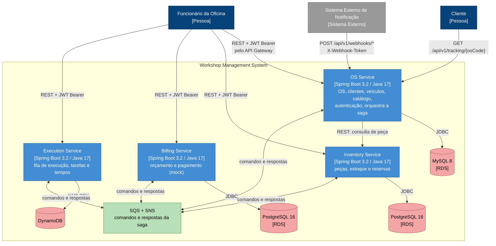
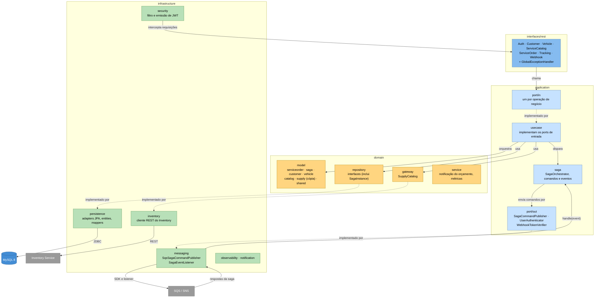

# Arquitetura

Documentação de arquitetura do Workshop Management System, usando o modelo **C4** (Contexto → Container → Componente) para descrever o sistema em níveis crescentes de detalhe.

O sistema deixou de ser um monólito e hoje são **quatro microsserviços** (OS, Inventory, Billing e Execution), cada um com banco próprio, que cooperam por uma **saga orquestrada** sobre SQS e SNS. Este documento descreve o estado atual. Para o modelo de dados do OS (diagrama entidade-relacionamento), ver a seção [Modelagem do Banco de Dados](../README.md#modelagem-do-banco-de-dados) no README; os demais serviços descrevem o seu modelo nos próprios READMEs. As decisões estão registradas como [ADRs](adr/) (os dos microsserviços e da saga são do [0015](adr/0015-split-into-four-services.md) ao [0021](adr/0021-infrastructure-per-service.md)) e [RFCs](rfc/).

## Visão de Nuvem

Como as peças se conectam em produção: o API Gateway é a entrada única e roteia cada prefixo da API para o serviço dono dele; os serviços conversam por filas e por um tópico; cada um tem o seu banco.

Repositórios: [os-service](https://github.com/Adriana-Meyer/fiap-tech-challenge-os-service) (este) · [inventory-service](https://github.com/Adriana-Meyer/fiap-tech-challenge-inventory-service) · [billing-service](https://github.com/Adriana-Meyer/fiap-tech-challenge-billing-service) · [execution-service](https://github.com/Adriana-Meyer/fiap-tech-challenge-execution-service) · [API Gateway + Lambda](https://github.com/Adriana-Meyer/fiap-tech-challenge-API-gateway-function-serverless) · [os-infrastructure](https://github.com/Adriana-Meyer/fiap-tech-challenge-os-infrastructure) (VPC, EKS, New Relic, tópico `saga-events`) · e, para cada serviço, o seu `*-infrastructure` (namespace e fila) e o seu `*-database-infrastructure` (banco). Ver [ADR 0021](adr/0021-infrastructure-per-service.md).

## A Saga

Aprovar um orçamento passa por três serviços, cada um com o seu banco, e não existe transação que cubra os três. O OS **orquestra**: envia um comando por vez, espera a resposta e decide o passo seguinte; se um passo falha, manda desfazer os anteriores. O estado fica na tabela `saga_instance` do OS e pode ser consultado em `GET /api/v1/service-orders/{id}/saga`. Decisão e alternativas no [ADR 0018](adr/0018-orchestrated-saga.md).

| Passo da saga | Quem executa | Resposta esperada |
|---|---|---|
| `GENERATE_BUDGET` | Billing | `BudgetGenerated` (total do orçamento) |
| `AWAIT_APPROVAL` | o cliente, pelo consultor ou pelo webhook | aprovação ou rejeição |
| `RESERVE_STOCK` | Inventory | `StockReserved` ou `StockReservationFailed` |
| `PROCESS_PAYMENT` | Billing | `PaymentApproved` ou `PaymentDeclined` |
| `ENQUEUE_EXECUTION` | Execution | `ExecutionEnqueued` ou `ExecutionEnqueueFailed` |
| `EXECUTING` | os mecânicos, no Execution | `ExecutionCompleted` |
| `CONSUME_STOCK` | Inventory | `StockConsumed` (passo pivô: nunca é desfeito) |

Estados da saga: `RUNNING`, `COMPLETED`, `REJECTED` (o cliente rejeitou o orçamento), `COMPENSATING` (um passo falhou e há desfazimentos pendentes) e `COMPENSATED`. A OS ganhou o status `CANCELLED` e continua em `WAITING_APPROVAL` enquanto a saga de aprovação roda.

### Caminho feliz

### Compensação: pagamento recusado

O gateway de pagamento do Billing é um mock determinístico: recusa quando a forma de pagamento é `mock-decline` ou o valor passa de um limite configurável. A recusa é uma **resposta**, não um erro.

### Compensação: estoque insuficiente

Nada foi reservado, então só o orçamento precisa ser cancelado.

A terceira compensação (falha ao enfileirar a execução) manda `RefundPayment` ao Billing e `ReleaseStock` ao Inventory. O estorno do Billing já cancela o orçamento.

### Garantias de entrega

- **Idempotência em duas pontas:** o OS descarta mensagens já tratadas (`processed_message`) e respostas que não correspondem ao passo atual; cada serviço trata um comando repetido sem refazer o efeito (não cobra duas vezes, não tira estoque duas vezes) e responde com o mesmo `messageId`.
- **Falha vai para a DLQ:** uma mensagem que um serviço não consegue tratar volta à fila e, depois de 3 tentativas, vai para a DLQ da fila ([ADR 0020](adr/0020-sqs-sns-messaging.md)).
- **Sem outbox:** a resposta é publicada depois de gravar; uma falha no meio é refeita pela reentrega e absorvida pela idempotência.

## Diagramas de Sequência

### Autenticação via CPF

O token é emitido pelo OS e leva a claim `role`; os demais serviços validam a assinatura com o mesmo segredo e usam a role do próprio token, sem consultar banco ([ADR 0017](adr/0017-shared-jwt-secret-with-role-claim.md)).

### Abertura de Ordem de Serviço

### Adição de uma peça à OS

É a única chamada síncrona entre serviços ([ADR 0019](adr/0019-supply-snapshot-over-rest.md)): o OS consulta o Inventory e guarda uma cópia do nome e do preço no item.

## Nível 1 — Contexto

Quem interage com o sistema e por quê:

## Nível 2 — Containers

Cada serviço expõe o próprio Swagger UI e `/v3/api-docs` (rotas dentro do próprio container). Pelo API Gateway só o Swagger do OS aparece; o dos outros serviços fica no load balancer de cada um.

## Nível 3 — Componentes

Todos os serviços seguem a mesma estrutura em quatro camadas ([ADR 0001](adr/0001-clean-architecture.md)): `interfaces/rest` conhece só as interfaces de `application/port/in`, os casos de uso implementam essas interfaces e dependem de abstrações do domínio, e a `infrastructure` implementa essas abstrações apontando de volta para dentro. Um teste ArchUnit em cada serviço falha o build se uma camada violar essa regra.

### OS Service

As setas tracejadas ("implementado por") são o ponto central da Clean Architecture: o domínio e a aplicação declaram o que precisam (`SupplyCatalog`, `SagaCommandPublisher`, os repositórios) e a infraestrutura implementa, de modo que trocar o SQS por outra fila, ou o REST do Inventory por outra forma de obter a peça, não toca no domínio.

### Inventory, Billing e Execution

| Serviço | Interfaces REST | Casos de uso e domínio | Infraestrutura |
|---|---|---|---|
| **Inventory** | `SupplyController`, `StockReservationController` (leitura) | CRUD de peças, ajuste de estoque e reserva (`ReserveStock`, `ReleaseStock`, `ConsumeStock`); domínio `Supply` e `StockReservation` | JPA/PostgreSQL com lock de linha, validação de JWT, listener de `inventory-commands`, publicador SNS |
| **Billing** | `BudgetController`, `PaymentController` (leitura) | `GenerateBudget`, `CancelBudget`, `ProcessPayment`, `RefundPayment`; domínio `Budget`, `Payment` e a port `PaymentGateway` | JPA/PostgreSQL, `MockPaymentGateway`, validação de JWT, listener de `billing-commands`, publicador SNS |
| **Execution** | `ExecutionController` (fila, iniciar e concluir tarefa, tempo médio) | `EnqueueExecution`, `StartTask`, `FinishTask`, `GetAverageExecutionTime`; domínio `ExecutionOrder` e `ExecutionTask` | adaptador DynamoDB com lock otimista, métrica `EXECUTION` no New Relic, validação de JWT, listener de `execution-commands`, publicador SNS |

Billing, Inventory e Execution só consultam por REST: orçamentos, pagamentos, reservas e a fila de execução são criados e alterados por comandos da saga, nunca por HTTP, para ninguém contornar o orquestrador.

## Decisões Técnicas

- **Quatro microsserviços, cada um com o seu banco** ([ADR 0015](adr/0015-split-into-four-services.md), [ADR 0016](adr/0016-database-per-service.md)): as fronteiras seguem quem é dono do dado e das regras. Clientes, veículos e catálogo ficam no OS por serem estáveis e lidos junto com a OS.
- **Saga orquestrada pelo OS** ([ADR 0018](adr/0018-orchestrated-saga.md)): substitui a transação única do monólito por passos com compensações, com um ponto de leitura do estado da saga.
- **SQS para comandos, SNS para respostas** ([ADR 0020](adr/0020-sqs-sns-messaging.md)): entrega "pelo menos uma vez" com idempotência nas duas pontas e DLQ por fila.
- **Uma única chamada síncrona entre serviços** ([ADR 0019](adr/0019-supply-snapshot-over-rest.md)): o OS consulta o Inventory ao adicionar uma peça e guarda uma cópia do nome e do preço.
- **JWT com segredo compartilhado e claim `role`** ([ADR 0017](adr/0017-shared-jwt-secret-with-role-claim.md)), stateless como no [ADR 0002](adr/0002-jwt-stateless-auth.md): cada serviço valida o token localmente e aplica as próprias regras de perfil, compatível com várias réplicas por trás do HPA ([DEPLOYMENT.md](DEPLOYMENT.md)).
- **Clean Architecture em cada serviço, verificada por ArchUnit** ([ADR 0001](adr/0001-clean-architecture.md)): `Repository`, não `Gateway`, para os acessos a dados, por consistência com a terminologia de Spring Data/DDD. O domínio é POJO puro, testável sem subir o Spring.
- **Duplicação consciente em vez de biblioteca compartilhada** ([ADR 0012](adr/0012-duplicated-cpf-validator.md)): cada serviço tem o seu `Money`, o seu filtro de JWT e o seu envelope de mensagem, para os repositórios continuarem independentes.
- **Infraestrutura como código por serviço** ([ADR 0021](adr/0021-infrastructure-per-service.md)): descoberta do cluster por nome, ResourceQuota por namespace, `apply` manual e ordem de subida e descida documentada.
- **Consistência eventual assumida**: no monólito, aprovar o orçamento baixava o estoque na mesma transação; agora a OS só vira `IN_EXECUTION` depois que estoque, pagamento e fila confirmam, e o progresso fica visível em `GET /service-orders/{id}/saga`.
