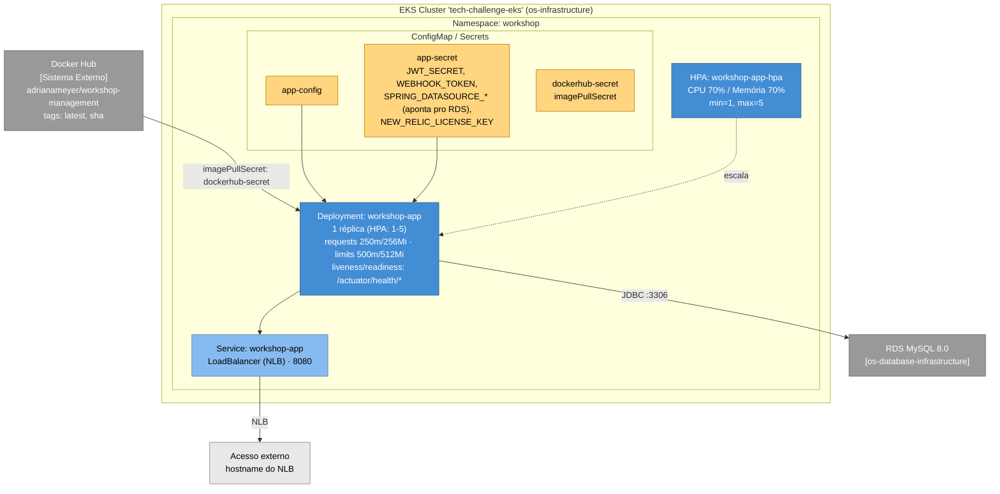

# Deploy e Infraestrutura

Como o Workshop Management System é conteinerizado, orquestrado e entregue na AWS real — Docker, Kubernetes (EKS), RDS e o pipeline de CI/CD.

Na Fase 4 o sistema são **quatro serviços** (OS, Inventory, Billing, Execution), cada um com repositório, pipeline, namespace e banco próprios ([ADR 0021](adr/0021-infrastructure-per-service.md)). Este documento detalha o OS, que é o modelo dos demais, e resume o que muda nos outros. Cada repositório de serviço só aplica os manifests da aplicação contra o cluster já existente; a infraestrutura vive em repositórios Terraform separados.

## Repositórios e ordem de uso

| Camada | Repositórios | O que provisionam |
|---|---|---|
| Base compartilhada | [os-infrastructure](https://github.com/Adriana-Meyer/fiap-tech-challenge-os-infrastructure) | VPC, cluster EKS `tech-challenge-eks`, New Relic, tópico `saga-events` e fila `os-saga-events` |
| Por serviço | `billing-infrastructure`, `inventory-infrastructure`, `execution-infrastructure` | namespace, ResourceQuota e a fila de comandos com DLQ |
| Banco | `os-database-infrastructure`, `billing-database-infrastructure`, `inventory-database-infrastructure` (RDS) e `execution-database-infrastructure` (DynamoDB) | o banco do serviço; as credenciais do RDS chegam como Secrets do repositório do serviço |
| Aplicação | `os-service`, `billing-service`, `inventory-service`, `execution-service` | manifests e deploy |
| Entrada | [API Gateway + Lambda](https://github.com/Adriana-Meyer/fiap-tech-challenge-API-gateway-function-serverless) | rotas por prefixo para os 4 serviços e a autenticação por CPF |

O namespace do OS é criado pelo próprio `deploy-aws.yml` do `os-service`; os outros três são criados pelos respectivos `*-infrastructure`.

**Subir (numa sessão do Lab), na ordem:**

1. `os-infrastructure`
2. `billing-infrastructure`, `inventory-infrastructure`, `execution-infrastructure` (as filas precisam existir antes dos serviços; um serviço que não encontra a sua fila falha na subida, [ADR 0020](adr/0020-sqs-sns-messaging.md))
3. os quatro `*-database-infrastructure`
4. o `deploy-aws.yml` de cada serviço (`action: deploy`)
5. o gateway, que descobre o hostname de cada serviço no cluster

**Desligar:** a ordem inversa. O `destroy` de cada serviço vem primeiro, porque apaga o `Service` e libera o NLB antes de o cluster ser destruído.

Todos os `apply` e `destroy` são manuais (`workflow_dispatch`).

### O que muda em cada serviço

| Serviço | Namespace | Service Kubernetes | HPA | Banco |
|---|---|---|---|---|
| OS | `workshop` | `workshop-app` | 1 a 5 | RDS MySQL 8 |
| Inventory | `inventory` | `inventory-service` | 1 a 2 | RDS PostgreSQL 16 |
| Billing | `billing` | `billing-service` | 1 a 2 | RDS PostgreSQL 16 |
| Execution | `execution` | `execution-service` | 1 a 2 | DynamoDB `execution-orders` |

Os namespaces `inventory`, `billing` e `execution` têm um ResourceQuota (1 CPU e 1Gi pedidos, 2 CPU e 2Gi de limite, 6 pods e 1 load balancer), dimensionado a partir dos manifests reais; o `workshop` é criado pelo deploy do OS e não tem quota. Os nós do cluster são `t3.large` (1 a 3, 2 por padrão).

O `deploy-aws.yml` de Inventory, Billing e Execution segue os mesmos passos do OS descritos abaixo, com duas diferenças: monta o ARN do tópico (`arn:aws:sns:<região>:<conta>:saga-events`) a partir da conta da sessão, porque eles publicam respostas nele, e o Execution não recebe credenciais de RDS. O OS recebe os nomes das filas e a URL do Inventory (`INVENTORY_BASE_URL`, dentro do cluster) pelo ConfigMap.

## O OS no cluster

Topologia da aplicação depois do `deploy-aws.yml` (namespace, ConfigMap/Secrets, Deployment, HPA e o Service `LoadBalancer`):

> HPA depende de um metrics-server (ou equivalente) disponível no cluster para ler CPU/memória — isso é responsabilidade do os-infrastructure, não deste repositório.

Manifestos em [`k8s/`](../k8s/): `00-namespace/`, `01-config/app-configmap.yaml` e `03-app/` (`deployment.yaml`, `hpa.yaml`, `service.yaml`).

## Pipeline de CI/CD

GitHub Actions ([`.github/workflows/`](../.github/workflows/)):

- **`ci-cd.yml`** — roda em todo push/PR para `develop`/`main`: `build-and-test` (`mvn verify`, gate JaCoCo ≥ 80%) e, só em push (nunca em PR), `build-and-push-image` (build + push da imagem para o Docker Hub: `latest` + `sha`). Não faz nenhum deploy — só valida e publica a imagem.
- **`deploy-aws.yml`** — disparado manualmente (`workflow_dispatch`), com escolha entre `deploy`/`destroy` e ambiente (`homologacao`/`producao`). É o único caminho de deploy do projeto:
  1. `aws eks update-kubeconfig` contra o cluster do os-infrastructure.
  2. Aplica `k8s/00-namespace/namespace.yaml` e `k8s/01-config/app-configmap.yaml`.
  3. Cria/atualiza o Secret `app-secret` a partir de GitHub Secrets — incluindo `SPRING_DATASOURCE_URL`/`_USERNAME`/`_PASSWORD` apontando para o RDS do os-database-infrastructure (chegam automaticamente via `gh secret set`, sem cópia manual) — e o `dockerhub-secret` (imagePullSecret).
  4. Aplica `k8s/03-app/deployment.yaml`, `hpa.yaml` e `service.yaml`.
  5. Espera o rollout, espera o hostname do NLB, faz smoke test em `/actuator/health`.
  - `action: destroy` desfaz na ordem inversa, deletando o Service **primeiro** (libera o NLB) antes do Deployment/HPA/secrets — importante para não deixar o NLB órfão (e cobrando) quando os repositórios os-infrastructure e os-database-infrastructure forem destruídos depois.

Fica `workflow_dispatch` manual permanentemente, inclusive no estado final entregue: essa é a alternativa adotada para economizar os recursos limitados do Lab (sessão de ~4h, cluster/RDS não ficam sempre no ar) — o deploy em si é automático de ponta a ponta assim que disparado, sem nenhuma intervenção manual durante a execução; só o gatilho é manual, para ser acionado quando for conveniente e a sessão do Lab estiver ativa.

> Este projeto já rodou um caminho de deploy local via **kind** (cluster efêmero dentro do próprio runner) durante boa parte do desenvolvimento — validação gratuita e independente de sessão do Lab, enquanto o deploy real na AWS ainda não existia. Com o deploy real testado e validado de ponta a ponta, esse caminho foi removido (ver [ADR 0014](adr/0014-remove-kind-deploy-path.md)); o histórico de como funcionava está em [ADR 0005](adr/0005-terraform-kind-ci-validation.md).

## Segurança e Secrets

- Nenhum valor sensível é commitado. Os secrets do `app-secret` (`JWT_SECRET`, `WEBHOOK_TOKEN`, credenciais do RDS, `NEW_RELIC_LICENSE_KEY`; o `WEBHOOK_TOKEN` existe só no OS) e do `dockerhub-secret` vêm de GitHub Secrets deste repositório, aplicados via `kubectl create secret ... --dry-run=client -o yaml | kubectl apply -f -` dentro do `deploy-aws.yml`.
- `k8s/secret.yaml.example` é só um template de referência (valores `CHANGE_ME`) — documenta a estrutura esperada, mas não é lido pelo workflow nem aplicado automaticamente.
- As credenciais do RDS (`RDS_DATASOURCE_URL`/`RDS_USERNAME`/`RDS_PASSWORD`) chegam automaticamente como Secrets deste repositório: o `terraform-apply.yml` do os-database-infrastructure faz `terraform output` e envia via `gh secret set` direto para cá (nunca aparecem em log).
- Credenciais AWS (`AWS_ACCESS_KEY_ID`/`AWS_SECRET_ACCESS_KEY`/`AWS_SESSION_TOKEN`) são as temporárias da sessão do AWS Academy Learner Lab — precisam ser atualizadas nos GitHub Secrets de **cada repositório** que faz deploy ou `terraform apply` (treze, ver [ADR 0021](adr/0021-infrastructure-per-service.md)) a cada nova sessão (~4h).
- **O `JWT_SECRET` precisa ter o mesmo valor nos quatro serviços** ([ADR 0017](adr/0017-shared-jwt-secret-with-role-claim.md)): o OS emite o token e os outros o validam com o mesmo segredo.
- Nos workflows, os secrets entram como variáveis de ambiente do passo (`env:`) e não são interpolados no script: um valor com `$` ou aspas não é alterado pelo shell. A senha gerada para o RDS usa um conjunto de caracteres que evita esses casos.
- Os pods acessam SQS, SNS e DynamoDB pelo role IAM do nó (`LabEksNodeRole`), sem credenciais da AWS dentro do Secret. Se o role do Lab não permitir essas ações, o plano alternativo é fornecer as credenciais da sessão por um Secret ([ADR 0020](adr/0020-sqs-sns-messaging.md)).
