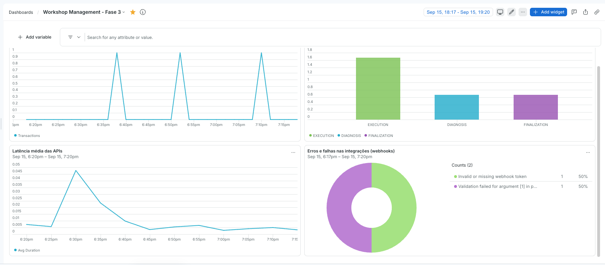

# Observabilidade (New Relic)

Detalhamento do que o agente New Relic ([README](../README.md#observabilidade-new-relic)) expõe, com prints reais do New Relic como exemplo de cada recurso.

## APM automático

Vem de graça com o agente Java, sem nenhuma instrumentação manual: tempo de resposta, Apdex, throughput e taxa de erro por transação web, além da lista das transações mais lentas.


## Métricas de infraestrutura do pod

CPU e memória do container `workshop-app`, correlacionadas automaticamente com o pod do Kubernetes pela mesma instrumentação.


## Dashboard customizado "Workshop Management"

Os 4 widgets construídos para os requisitos de observabilidade: volume de transações, tempo médio por status da OS (via o custom event `ServiceOrderStatusDuration`, ver README), latência média das APIs e erros/falhas de integração de webhook.



## Logs estruturados e correlacionados

Logs em JSON (`logstash-logback-encoder`) com `trace.id`/`span.id` injetados automaticamente no MDC — cada linha de log já chega correlacionada com o trace da requisição que a gerou, sem código de correlação manual.


## Traces distribuídos

Rastreamento de uma requisição por todas as camadas que ela passa (filtros do Spring Security, chamadas ao banco, código da aplicação), com o tempo gasto em cada segmento.


## Observabilidade da saga

Os quatro serviços usam o mesmo agente do New Relic e o mesmo formato de log (JSON, com `trace.id`/`span.id`), cada um com o seu nome de aplicação. O que muda com a saga é que uma operação de negócio passa por quatro serviços e pelo SQS.

- **`sagaId` nos logs:** cada serviço coloca o `sagaId` no MDC ao tratar uma mensagem da saga, e o encoder JSON o expõe como campo de cada linha de log. Para seguir uma saga inteira, filtre pelo campo `sagaId` em todos os serviços de uma vez, por exemplo no New Relic Logs: `sagaId:"<uuid>"`. O `sagaId` de uma OS está em `GET /api/v1/service-orders/{id}/saga`.
- **O trace não atravessa o SQS:** o agente propaga o trace entre chamadas HTTP, mas a mensagem do SQS não carrega o contexto do trace. Por isso o `sagaId` é o elo entre os serviços, e não o `trace.id`. A chamada síncrona do OS ao Inventory (consulta de peça) aparece como segmento externo do trace do OS. Se o trace entre serviços aparece no Lab é uma das verificações pendentes da validação na AWS.
- **Estado da saga:** `saga_instance` guarda o passo atual, o status e o motivo da falha. Uma saga em `COMPENSATING` por muito tempo indica uma confirmação de compensação que não chegou.
- **DLQs:** mensagem que um serviço não consegue tratar vai para a DLQ da fila (`*-commands-dlq`) depois de 3 tentativas. Uma DLQ com mensagens é o sinal de que um serviço está falhando no tratamento (ver [ADR 0020](adr/0020-sqs-sns-messaging.md)).
- **Métricas de status:** o custom event `ServiceOrderStatusDuration` continua sendo publicado pelo OS, e o Execution publica o do status `EXECUTION` ao concluir uma tarefa, para o tempo médio por status do dashboard não perder a etapa de execução.

## Dashboard da saga (consultas NRQL)

NRQL é a linguagem de consulta do New Relic, parecida com SQL: cada widget de um dashboard é uma consulta. As consultas abaixo montam o dashboard "Workshop Management: saga" e usam os nomes reais que os serviços emitem:

| Serviço | `appName` (APM) e `entity.name` (logs) | Namespace |
|---|---|---|
| OS | `workshop-os-service` | `workshop` |
| Billing | `workshop-billing-service` | `billing` |
| Inventory | `workshop-inventory-service` | `inventory` |
| Execution | `workshop-execution-service` | `execution` |

> O OS se chamava `workshop-management` no New Relic. Os dados enviados antes da padronização do nome continuam sob esse nome; para consultar o histórico, inclua-o junto (`WHERE appName IN ('workshop-os-service', 'workshop-management')`).

> As consultas partem do que o código emite (mensagens de log, atributo `sagaId` e o custom event `ServiceOrderStatusDuration`), mas ainda não foram executadas no New Relic. Se algum widget vier vazio, confira no *Query builder* o nome do atributo (por exemplo, `entity.name` ou `service.name`) e ajuste.

### Resultado das sagas

**Sagas concluídas e compensadas por hora** (gráfico de linhas). O OS recebe `StockConsumed` no último passo e loga `is compensated` quando termina o desfazimento:

```sql
SELECT filter(count(*), WHERE message LIKE 'Received StockConsumed%') AS 'Concluídas',
       filter(count(*), WHERE message LIKE 'Saga % is compensated') AS 'Compensadas'
FROM Log WHERE entity.name = 'workshop-os-service'
TIMESERIES 1 hour SINCE 1 day ago
```

**Causa das compensações** (pizza ou barras):

```sql
SELECT count(*) FROM Log
WHERE entity.name = 'workshop-os-service'
  AND (message LIKE 'Received PaymentDeclined%'
    OR message LIKE 'Received StockReservationFailed%'
    OR message LIKE 'Received ExecutionEnqueueFailed%')
FACET capture(message, r'Received (?P<evento>\w+)')
SINCE 1 day ago
```

**Respostas ignoradas pelo orquestrador** (entrega repetida, resposta fora do passo ou saga desconhecida). Um pico indica reentregas em excesso:

```sql
SELECT count(*) FROM Log
WHERE entity.name = 'workshop-os-service' AND message LIKE 'Ignoring%'
TIMESERIES 1 hour SINCE 1 day ago
```

### Fluxo entre os serviços

**Mensagens da saga tratadas por serviço** (cada serviço loga `Received <tipo>` ao tratar uma mensagem):

```sql
SELECT count(*) FROM Log
WHERE message LIKE 'Received %' AND entity.name LIKE 'workshop-%'
FACET entity.name TIMESERIES 5 minutes SINCE 1 hour ago
```

**Mensagens por tipo** (mostra onde a saga está concentrada):

```sql
SELECT count(*) FROM Log
WHERE message LIKE 'Received %'
FACET capture(message, r'Received (?P<tipo>\w+)') SINCE 1 day ago
```

**Seguir uma saga pelos quatro serviços.** Use como tabela de consulta ao investigar; troque o `sagaId` pelo valor de `GET /api/v1/service-orders/{id}/saga`:

```sql
SELECT entity.name, message FROM Log
WHERE sagaId = '00000000-0000-0000-0000-000000000000'
SINCE 1 day ago LIMIT MAX
```

### Saúde dos serviços

**Latência média e p95 por serviço:**

```sql
SELECT average(duration) AS 'Média (s)', percentile(duration, 95) AS 'p95 (s)'
FROM Transaction
WHERE appName IN ('workshop-os-service', 'workshop-billing-service',
                  'workshop-inventory-service', 'workshop-execution-service')
FACET appName TIMESERIES SINCE 1 hour ago
```

**Taxa de erro por serviço:**

```sql
SELECT percentage(count(*), WHERE error IS true) AS 'Erros (%)'
FROM Transaction
WHERE appName IN ('workshop-os-service', 'workshop-billing-service',
                  'workshop-inventory-service', 'workshop-execution-service')
FACET appName TIMESERIES SINCE 1 hour ago
```

**Logs de erro por serviço:**

```sql
SELECT count(*) FROM Log
WHERE level = 'ERROR' AND entity.name LIKE 'workshop-%'
FACET entity.name TIMESERIES SINCE 1 hour ago
```

**CPU por namespace** (mostra o consumo de cada serviço dentro da quota):

```sql
SELECT average(cpuUsedCores) FROM K8sContainerSample
WHERE namespaceName IN ('workshop', 'billing', 'inventory', 'execution')
FACET namespaceName TIMESERIES SINCE 1 hour ago
```

### Tempo por etapa da OS

O OS publica o custom event `ServiceOrderStatusDuration` (diagnóstico e finalização) e o Execution publica o da etapa `EXECUTION` ao concluir uma tarefa:

```sql
SELECT average(durationMinutes) AS 'Minutos (média)'
FROM ServiceOrderStatusDuration FACET status SINCE 1 week ago
```

### O que o New Relic não mostra

A profundidade das filas de comando e das DLQs (`*-commands-dlq`) é métrica do SQS, não do New Relic. Acompanhe-a no CloudWatch (`ApproximateNumberOfMessagesVisible`) e crie um alarme para a DLQ: uma mensagem nela significa que um serviço não conseguiu tratar um comando depois das 3 tentativas ([ADR 0020](adr/0020-sqs-sns-messaging.md)).

### Alertas sugeridos

- **Compensações em alta:** mais de N sagas compensadas em 15 minutos (consulta de "Sagas concluídas e compensadas").
- **Erros em qualquer serviço:** taxa de erro acima de 5% por 5 minutos (consulta de "Taxa de erro por serviço").
- **DLQ com mensagens:** alarme no CloudWatch.

