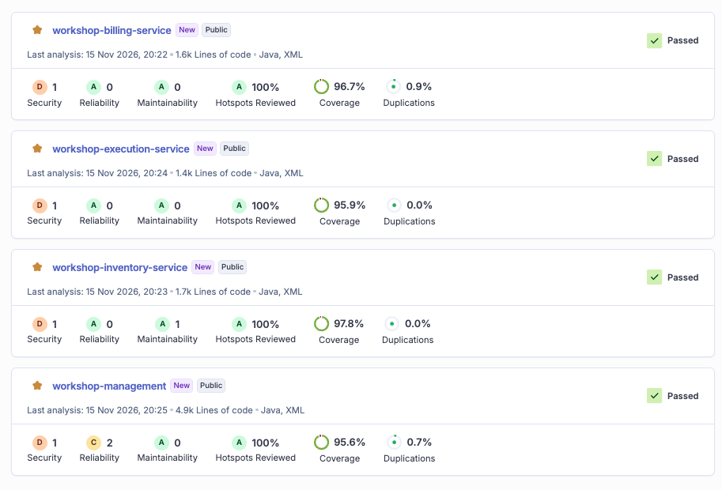
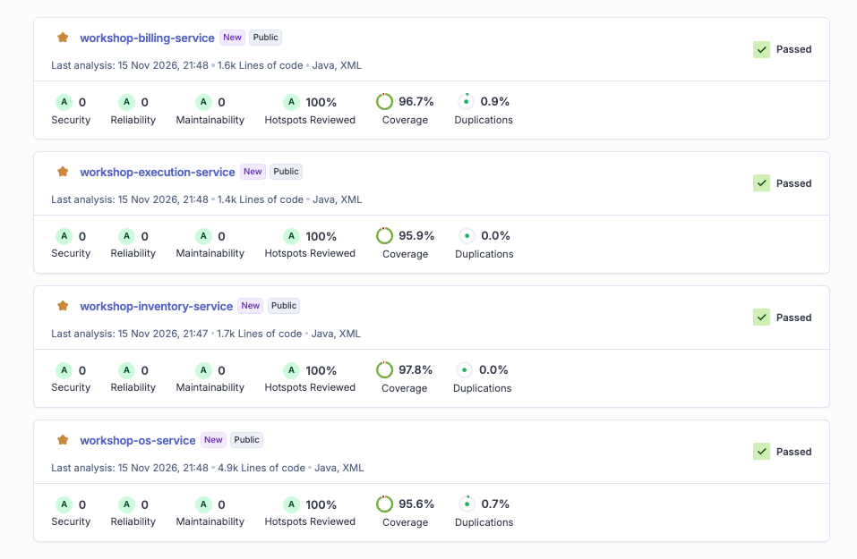

# Visão geral da solução

Resumo da arquitetura, da estratégia da saga e da justificativa das escolhas. Os trechos marcados com **[A COMPLETAR]** dependem de evidências que só existem depois da validação na AWS.

## 1. Visão geral

O Workshop Management System, era um monólito e foi dividido em **quatro microsserviços** independentes. Cada um tem repositório, pipeline de CI/CD, infraestrutura como código e banco de dados próprios, e todos rodam no mesmo cluster EKS, cada um em um namespace.

| Serviço | Responsabilidade | Banco | Repositório |
|---|---|---|---|
| **OS** | clientes, veículos, catálogo de serviços, autenticação, ordens de serviço, acompanhamento público e **orquestração da saga** | MySQL 8 (RDS) | `fiap-tech-challenge-os-service` |
| **Billing** | orçamento e pagamento (gateway de pagamento simulado) | PostgreSQL 16 (RDS) | `fiap-tech-challenge-billing-service` |
| **Inventory** | peças, estoque e reservas de estoque | PostgreSQL 16 (RDS) | `fiap-tech-challenge-inventory-service` |
| **Execution** | fila de execução, tarefas e tempo de execução | DynamoDB | `fiap-tech-challenge-execution-service` |

Infraestrutura: `os-infrastructure` (VPC, EKS, New Relic, tópico `saga-events`), um `*-infrastructure` e um `*-database-infrastructure` por serviço, e o repositório do API Gateway com a Lambda de autenticação. A lista completa, com a ordem de subida, está em [DEPLOYMENT.md](DEPLOYMENT.md).

## 2. Desenho da arquitetura

O diagrama de nuvem (gateway, serviços, bancos, filas e New Relic) e os diagramas C4 estão em [ARCHITECTURE.md](ARCHITECTURE.md). O diagrama de **Visão de Nuvem** é o principal; o fluxo da saga e as duas compensações estão logo abaixo dele.

## 3. Justificativa da divisão em serviços

A divisão segue **quem é dono do dado e das regras** ([ADR 0015](adr/0015-split-into-four-services.md)):

- **Inventory**, **Billing** e **Execution** têm regras próprias, ciclos de mudança diferentes e escalam por motivos diferentes (a consulta de peças, o pagamento e a fila de trabalho da oficina).
- **Clientes, veículos e catálogo permanecem no OS**: são dados estáveis, lidos junto com a OS em quase toda operação, e separá-los criaria chamadas síncronas entre serviços sem ganho de autonomia.
- **Um banco por serviço, com o motor adequado** ([ADR 0016](adr/0016-database-per-service.md)): relacional onde há integridade e transações locais (OS, Billing, Inventory) e DynamoDB para a fila de execução, que é acessada por uma chave (a OS) e tem documentos autocontidos. O conjunto atende a exigência de ao menos um banco SQL e um NoSQL.
- **Nenhum serviço lê o banco de outro.** O que um precisa do outro vem por API ou mensagem.

## 4. Comunicação entre serviços

| Tipo | Onde | Por quê |
|---|---|---|
| **REST síncrono** | OS consulta o Inventory ao adicionar uma peça à OS ([ADR 0019](adr/0019-supply-snapshot-over-rest.md)) | o usuário precisa da resposta na hora (a peça existe? qual o preço?), e o preço é copiado para o item da OS |
| **Mensageria assíncrona** | toda a saga: comandos por SQS, respostas por SNS → SQS ([ADR 0020](adr/0020-sqs-sns-messaging.md)) | os serviços não ficam presos ao tempo de resposta uns dos outros, e uma fila com DLQ absorve falhas temporárias |

Autenticação: o OS emite o JWT com a claim `role` e os demais serviços o validam com o mesmo segredo, sem consultar o OS ([ADR 0017](adr/0017-shared-jwt-secret-with-role-claim.md)).

## 5. Estratégia da saga

**Padrão: saga orquestrada, com o OS como orquestrador** ([ADR 0018](adr/0018-orchestrated-saga.md)). Aprovar um orçamento envolve Inventory, Billing e Execution, cada um com o seu banco, e não existe transação que cubra os três. O OS envia um comando por vez, espera a resposta e decide o passo seguinte; se um passo falha, manda desfazer os anteriores. O estado da saga fica na tabela `saga_instance` e é consultável em `GET /api/v1/service-orders/{id}/saga`.

**Fluxo de sucesso:** gerar orçamento (Billing) → aguardar aprovação → reservar estoque (Inventory) → cobrar (Billing) → enfileirar a execução (Execution) → a OS passa a `IN_EXECUTION` → ao concluir a execução, a OS vai a `FINISHED` e o estoque reservado é consumido (Inventory). O consumo é o passo pivô: depois dele não se desfaz.

**Compensações:**

| Falha em | O que é desfeito | Resultado |
|---|---|---|
| estoque insuficiente | `CancelBudget` | OS `CANCELLED`, saga `COMPENSATED` |
| pagamento recusado | `ReleaseStock` e `CancelBudget` | OS `CANCELLED`, saga `COMPENSATED` |
| falha ao enfileirar a execução | `RefundPayment` (que já cancela o orçamento) e `ReleaseStock` | OS `CANCELLED`, saga `COMPENSATED` |

**Por que orquestração e não coreografia:** com a coreografia o fluxo e as compensações ficariam espalhados em quatro bases de código. Com um orquestrador o fluxo é lido num só lugar e o estado da saga é consultável.

**Garantias de entrega:**
- Entrega "pelo menos uma vez" com **idempotência nas duas pontas**: o OS descarta mensagens já tratadas (`processed_message`) e respostas fora do passo atual; cada serviço repete a mesma resposta ao receber um comando repetido, sem refazer o efeito (não cobra duas vezes, não tira estoque duas vezes).
- **DLQ** em cada fila de comando, depois de 3 tentativas.
- **Concorrência:** duas confirmações de compensação podem chegar juntas; a linha da saga é lida com lock pessimista, e há um teste que falha sem ele.
- **Limitação assumida:** não há outbox transacional. O comando é publicado antes do commit e a resposta depois de gravar, e uma falha no meio é absorvida pela reentrega e pela idempotência. O outbox fica registrado como melhoria.

**Pagamento:** simulado por um gateway determinístico no Billing (recusa quando a forma de pagamento é `mock-decline` ou quando o valor passa de um limite configurável), o que torna a compensação de pagamento reproduzível.

## 6. Justificativa das tecnologias

| Escolha | Motivo |
|---|---|
| **Java 21 + Spring Boot 3.2** em todos os serviços | continuidade com o código existente e uma única stack para o time manter |
| **Clean Architecture + ArchUnit** ([ADR 0001](adr/0001-clean-architecture.md)) | mensageria, banco e pagamento ficam atrás de portas; trocar o SQS ou o gateway de pagamento não toca no domínio, e o build falha se uma camada violar a regra |
| **SQS + SNS** ([ADR 0020](adr/0020-sqs-sns-messaging.md)) | gerenciados e disponíveis no AWS Academy; Kafka ou RabbitMQ exigiriam operar um broker num ambiente de orçamento limitado |
| **PostgreSQL e MySQL no RDS, DynamoDB** | ver seção 3 |
| **EKS, um namespace por serviço** | isolamento por serviço, ResourceQuota e HPA próprios |
| **Terraform por serviço** ([ADR 0021](adr/0021-infrastructure-per-service.md)) | a infraestrutura acompanha o serviço; o cluster é descoberto pelo nome, sem copiar endereços entre repositórios |
| **API Gateway + Lambda** | entrada única, autenticação por CPF e roteamento por prefixo para o serviço dono de cada rota |
| **Flyway, Testcontainers, LocalStack** | migrations versionadas e testes de integração contra bancos e filas reais |
| **New Relic** | agente em cada serviço, `sagaId` em todo log para seguir uma saga pelos quatro serviços |

## 7. Qualidade e testes

- **Cobertura:** gate de JaCoCo de **80%** no build de cada serviço, e o *quality gate* do SonarQube Cloud no CI. Testes por serviço: OS 263, Billing 112, Inventory 117 e Execution 88 (build em Java 21, 2026-11-15). A cobertura medida pelo Sonar está na tabela abaixo.
- **Teste de integração ponta a ponta:** `e2e/` do OS sobe os quatro serviços reais com LocalStack e bancos em contêineres e exercita o fluxo de sucesso e as compensações de pagamento recusado e de estoque insuficiente, conferindo as DLQs vazias.
- **Arquitetura:** três regras ArchUnit em cada serviço.
- **BDD (Cucumber):** no OS, em Gherkin, contra MySQL e LocalStack, com os outros três serviços simulados: sucesso, pagamento recusado, estoque insuficiente e falha ao enfileirar a execução (as três compensações). Ver o [README](../README.md#testes-bdd-cucumber).
- **SonarQube Cloud nos CIs:** cada serviço roda a análise no `build-and-test` e o CI espera o *quality gate*. Projetos: [OS](https://sonarcloud.io/project/overview?id=Adriana-Meyer_fiap-tech-challenge-os-service), [Billing](https://sonarcloud.io/project/overview?id=Adriana-Meyer_fiap-tech-challenge-billing-service), [Inventory](https://sonarcloud.io/project/overview?id=Adriana-Meyer_fiap-tech-challenge-inventory-service) e [Execution](https://sonarcloud.io/project/overview?id=Adriana-Meyer_fiap-tech-challenge-execution-service). Resultado da análise da branch `develop` (2026-11-15):

  | Serviço | Quality gate | Cobertura | Duplicação | Linhas de código | Segurança | Confiabilidade | Manutenibilidade | *Hotspots* revisados |
  |---|---|---|---|---|---|---|---|---|
  | OS | Aprovado | 95,6% | 0,7% | 4,9 mil | A | A | A | 100% |
  | Billing | Aprovado | 96,7% | 0,9% | 1,6 mil | A | A | A | 100% |
  | Inventory | Aprovado | 97,8% | 0,0% | 1,7 mil | A | A | A | 100% |
  | Execution | Aprovado | 95,9% | 0,0% | 1,4 mil | A | A | A | 100% |

  Primeira análise, antes das correções (o projeto do OS ainda aparece com o nome antigo, `workshop-management`, depois padronizado para `workshop-os-service`):

  

  Análise atual, depois das correções:

  

  **Limitação do plano gratuito:** o SonarQube Cloud analisa apenas a branch principal do projeto (`develop`) e os PRs para ela. Todo código que chega à `main` entra por uma release criada a partir da `develop`, onde já foi analisado e aprovado; por isso o CI não executa a análise em push nem em PR para a `main`.

  A primeira análise apontou três coisas, todas tratadas: a desativação do CSRF (alerta de segurança em cada serviço, falso positivo porque as APIs são *stateless* com o JWT no cabeçalho, agora justificada no código), o cálculo de duração entre datas sem fuso no OS (corrigido, com testes para a virada do horário de verão) e um teste do Inventory sem asserção (corrigido). Em seguida, todas as notas passaram a A.

## 8. CI/CD e proteção de branches

Cada repositório de serviço roda `build-and-test` (build, testes, gate de cobertura e *quality gate* do Sonar) em todo PR e, no push, publica a imagem no Docker Hub. Os repositórios de infraestrutura e o gateway validam o Terraform (`Format & Validate`) em todo PR.

**Proteção de branches:** as branches `develop` e `main` dos 13 repositórios exigem que o check de CI passe antes do merge (GitHub Actions): `Build & Test` no OS, `build-and-test` nos demais serviços, `Format & Validate` na infraestrutura e `Build Lambda, Format & Validate` no gateway.

**Releases:** o código chega à `main` por uma branch `release/X.Y.Z`; ao mergear, um workflow cria a tag `X.Y.Z` e a GitHub Release com notas automáticas, nos 13 repositórios (ver [DEPLOYMENT.md](DEPLOYMENT.md#releases)).

O deploy no EKS é um workflow por serviço: manual (`workflow_dispatch`) ou automático, depois do CI da `main`, quando a variável `AUTO_DEPLOY` é `true`, o que na prática acontece ao mergear uma release. **[A COMPLETAR: validação do deploy automático na AWS]**

## 9. Observabilidade

Agente New Relic em cada serviço, logs em JSON com `trace.id`, `span.id` e `sagaId`, e as métricas de status da OS ([OBSERVABILITY.md](OBSERVABILITY.md)). O contexto de trace não atravessa o SQS, por isso o `sagaId` é o elo entre os serviços. **[A COMPLETAR: dashboard da saga e prints]**

## 10. Validação na AWS

**[A COMPLETAR após a sessão do Lab: quatro deploys, a OS percorrendo os quatro serviços pelo API Gateway, uma saga com falha compensando, o dashboard no New Relic.]**

## 11. Limitações conhecidas

- Sem outbox transacional (seção 5).
- Segredo do JWT compartilhado entre os serviços: quem o obtém emite tokens para todos ([ADR 0017](adr/0017-shared-jwt-secret-with-role-claim.md)).
- A role de um token vale até ele expirar (24 h).
- O Swagger pelo API Gateway mostra só o do OS; o de cada um dos outros serviços fica no load balancer do próprio serviço.
- Consistência eventual: a OS só vira `IN_EXECUTION` depois que estoque, pagamento e fila confirmam.
